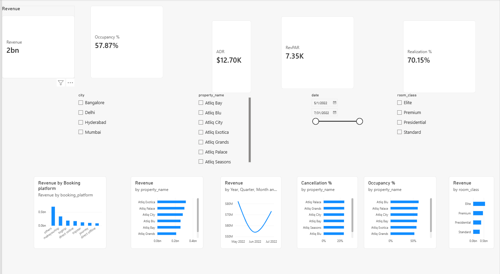

# Hotel Management Power BI Dashboard

## Project Overview

This project is an end-to-end **Hotel Management Data Analytics project** developed using **Microsoft Power BI**.

The goal of the project is to transform hotel booking data into an interactive dashboard that helps hotel management understand business performance, revenue trends, occupancy, booking platforms, room classes, and cancellations.

The dashboard allows users to interact with the data using filters for **City, Property, Date, and Room Class**.

---

## Business Objectives

The dashboard was designed to help answer important hotel business questions such as:

- How much revenue is being generated?
- What is the overall occupancy rate?
- What is the Average Daily Rate (ADR)?
- What is the Revenue per Available Room (RevPAR)?
- What percentage of bookings are successfully realized?
- Which booking platforms generate the most revenue?
- Which room classes generate the most revenue?
- Which properties have the highest cancellation rates?
- How does revenue change over time?
- How does hotel performance vary by city and property?

---

## Dashboard KPIs

The dashboard includes the following key performance indicators:

| KPI | Description |
|---|---|
| **Revenue** | Total realized revenue from hotel bookings |
| **Occupancy %** | Percentage of available rooms that were occupied |
| **ADR** | Average Daily Rate generated from successful bookings |
| **RevPAR** | Revenue generated per available room |
| **Realization %** | Percentage of bookings that resulted in a completed stay |
| **Cancellation %** | Percentage of bookings that were cancelled |

All percentage and decimal-based metrics are displayed using **2 decimal places**.

---

## Dashboard Visualizations

### Revenue by Date

A line chart showing the trend of hotel revenue over time using monthly data.

**Fields used:**
- `dim_date[mmm yy]`
- `Revenue`

This helps identify changes and trends in revenue performance.

### Revenue by Booking Platform

A column chart comparing revenue generated through different booking platforms.

**Fields used:**
- `booking_platform`
- `Revenue`

This helps identify which booking channels contribute the most revenue.

### Revenue by Room Class

A chart comparing revenue generated by different room classes.

**Fields used:**
- `room_class`
- `Revenue`

This helps management understand which room categories generate the most revenue.

### Cancellation % by Property

A chart comparing cancellation rates across hotel properties.

**Fields used:**
- `property_name`
- `Cancellation %`

This helps identify properties experiencing higher cancellation levels.

---

## Interactive Filters

The dashboard includes four slicers that allow users to explore the data interactively.

### City

Filters the dashboard based on hotel city.

### Property

Filters results for a specific hotel property.

### Date

Allows users to analyze performance over a selected date or period.

### Room Class

Filters results based on the selected room category.

These filters interact with the dashboard KPIs and visualizations.

---

## Data Model

The Power BI project uses a relational data model consisting of five main tables:

```text
                    dim_date
                       |
                       |
                       v
fact_bookings ---- dim_hotels
      |
      |
      v
fact_aggregated_bookings
      |
      |
      v
   dim_rooms
```

### Main Tables

#### `fact_bookings`

Contains booking-level information used to analyze:

- Bookings
- Revenue
- Cancellations
- Checked-out bookings
- Booking platforms
- Booking status

#### `fact_aggregated_bookings`

Contains aggregated booking information used for metrics such as:

- Successful bookings
- Capacity
- Occupancy

#### `dim_date`

Contains date-related information used for:

- Date filtering
- Monthly analysis
- Revenue trends
- Time-based analysis

#### `dim_hotels`

Contains hotel property information such as:

- Property name
- City
- Hotel details

#### `dim_rooms`

Contains room information such as:

- Room class
- Room category

---

## DAX Measures

Several DAX measures were created to calculate the main business metrics.

Example:

```DAX
Realization % =
DIVIDE(
    [Checked Out Bookings],
    [Total Bookings],
    0
)
```

Other measures used in the dashboard include:

- Revenue
- Total Bookings
- Successful Bookings
- Checked Out Bookings
- ADR
- RevPAR
- Occupancy %
- Cancellation %
- Realization %

The measures allow the dashboard to dynamically respond to slicers and filters.

---

## Data Preparation

The project followed an end-to-end data analytics workflow:

```text
Raw Data
   |
   v
Data Loading
   |
   v
Data Cleaning
   |
   v
Data Transformation
   |
   v
Data Modeling
   |
   v
DAX Measures
   |
   v
Data Visualization
   |
   v
Interactive Dashboard
   |
   v
Business Insights
```

Data preparation and transformation were performed using **Power Query** within Power BI.

---

## Tools and Technologies

- Microsoft Power BI
- Power Query
- DAX
- Data Modeling
- GitHub

---

## Project Files

This repository contains:

```text
hotel-management-powerbi-dashboard/
|
├── Hotel_Management_Dashboard.pbix
├── dashboard.png
└── README.md
```

### `Hotel_Management_Dashboard.pbix`

The complete Power BI project containing:

- Data model
- Relationships
- Power Query transformations
- DAX measures
- Dashboard visuals
- Interactive slicers

### `dashboard.png`

Preview image of the completed Power BI dashboard.

### `README.md`

Project documentation and explanation.

---

## Dashboard Preview



---

## Key Business Insights

The dashboard can be used by hotel management to:

- Monitor overall revenue performance.
- Track occupancy and room utilization.
- Compare revenue across booking platforms.
- Identify high-performing room classes.
- Monitor cancellation patterns by property.
- Analyze revenue trends over time.
- Compare performance across different cities and properties.
- Make data-driven decisions about hotel operations and revenue management.

---

## How to Use the Project

1. Download the `.pbix` file from this repository.
2. Open it using Microsoft Power BI Desktop.
3. Allow the data model to load.
4. Use the slicers to filter the dashboard.
5. Select different cities, properties, dates, or room classes.
6. Review the KPIs and visualizations to analyze hotel performance.

---

## Project Information

**Project Type:** End-to-End Data Analytics Project

**Domain:** Hotel Management / Hospitality

**Visualization Tool:** Microsoft Power BI

**Data Analysis:** DAX and Power Query

**Portfolio:** GitHub

---

## Author

**Leonard Muhati**

Data & AI | Software Engineering | Data Analytics

---

## Project Summary

This project demonstrates the use of **Power BI, Power Query, DAX, data modeling, and data visualization** to transform hotel booking data into an interactive business intelligence dashboard.

The final dashboard provides a centralized view of hotel performance and enables users to explore key business metrics through interactive filters.
